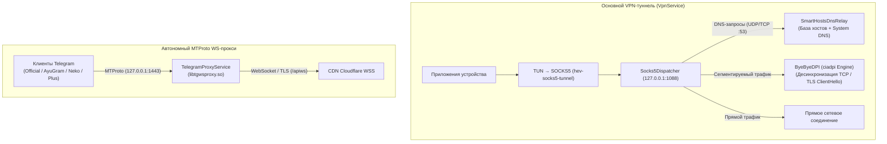

# MultiBypass for Android

  <h3>Сетевая утилита раздельной маршрутизации, тестирования устойчивости соединений и анализа транспортных протоколов для Android 9+</h3>

  

    
    
    
    
    
  

---

## ⚠️ Отказ от ответственности / Disclaimer

> [!IMPORTANT]
> **Исключительно в исследовательских, диагностических и образовательных целях (Educational & Research Purpose Only)**
>
> Данное программное обеспечение разработано как инженерный инструмент для:
> - анализа работы сетевых протоколов стека TCP/IP, UDP и DNS (включая RFC 8484 DNS-over-HTTPS);
> - исследования поведения промежуточных сетевых узлов (Middleboxes) при фрагментации и десинхронизации TCP-сегментов;
> - тестирования механизмов избирательной маршрутизации (Split-tunneling) на уровне сетевого стека Android (`VpnService`).
>
> **Ограничение ответственности:**
> 1. Автор проекта не поощряет, не призывает и не одобряет использование данного программного обеспечения для совершения противоправных действий или нарушения законодательства какой-либо юрисдикции.
> 2. Программное обеспечение предоставляется на условиях **«AS IS» («Как есть»)**, без каких-либо явных или подразумеваемых гарантий пригодности для конкретных целей.
> 3. Вся ответственность за сценарии практического применения программы возлагается исключительно на конечного пользователя.
> 4. Проект является некоммерческой интеграционной сборкой независимых открытых компонентов (Open Source) и не содержит вредоносного программного кода.

---

## 🏗️ Схема архитектуры

MultiBypass объединяет локальный VPN-шлюз и диспетчеризацию сетевых потоков на уровне устройства:

---

## 🌟 Основные функциональные модули

### 1. Интеллектуальная десинхронизация TCP/TLS (ByeDPI)
- Низкоуровневая фрагментация и сегментация TCP-потока, манипуляции с TTL и деление TLS ClientHello для предотвращения деградации соединений и снижения задержек.
- Библиотека проверенных пресетов: от базовых сплитов до комбинированных многоступенчатых цепочек.
- **Автоматический замер метрик (Benchmark / Автоподбор)**: фоновое циклическое тестирование стратегий с замером времени сетевого отклика (RTT, latency в мс) к контрольным узлам и мгновенная активация лучшего профиля.
- Гранулярная фильтрация целевых доменов и приложений.

### 2. Автономный WebSocket-прокси для Telegram
- Независимый локальный MTProto-прокси демон на порту `127.0.0.1:1443` (инкапсуляция в WebSocket/TLS через сеть Cloudflare `/apiws`).
- Полная автономность: работает независимо от основного VPN-туннеля (не требует включения Telegram в список раздельного туннелирования).
- Управление в один клик: плитка Quick Settings в системной шторке Android и мгновенный экспорт настроек прокси в клиенты Telegram (официальный, Nekogram, AyuGram, Plus и др.).
- Высокая стабильность: удержание WakeLock во время активности, защитный тайм-аут остановки и мониторинг объема переданного трафика в реальном времени.

### 3. Локальный SmartHosts & DNS-релей
- Мгновенная локальная адресация (0 мс) зарубежных облачных сервисов (AI-платформы, средства разработки, дизайн-системы) через европейские SNI-шлюзы по проверенной базе `smart-no-crutch`.
- Все стандартные системные DNS-запросы направляются напрямую в DNS оператора связи через защищенный сокет (`protect()`), гарантируя полную совместимость с локальными ресурсами, банковскими клиентами и государственными сервисами.
- Автоматическое исключение локальных доменов для сохранения максимальной скорости соединения.

### 4. Бесшовный хэндовер сетей (Wi-Fi ↔ Мобильная сеть)
- Мониторинг состояния сети на уровне `NetworkCallback`: при переключении между Wi-Fi и LTE соединение мгновенно адаптируется, сокеты обновляются без замирания трафика.
- Защитные тайм-ауты бездействия сокетов, предотвращающие утечки дескрипторов.

### 5. Сетевой доктор и диагностика
- Экспресс-проверка сетевого окружения в один клик: замер пинга, проверка доступности локальных шлюзов и качества десинхронизации TCP.

### 6. Избирательная маршрутизация (Strict Split-Tunneling)
- Возможность выбора конкретных приложений устройства для работы через оптимизированный сетевой стек (`addAllowedApplication`).
- Работа в виде единого системного VPN-сервиса с низким энергопотреблением и одним информативным уведомлением в шторке.

---

## 📥 Загрузка (Сборки APK)

Готовые скомпилированные и подписанные пакеты размещаются в разделе релизов репозитория:  
👉 **[Перейти к релизу MultiBypass v3.1.1 на GitHub](https://github.com/ntvampire/MultiBypass/releases/latest)**

- **`MultiBypass-v3.1.1-arm64-v8a.apk`** — 64-битная архитектура ARM (рекомендуется для большинства современных устройств на Android 9+).
- **`MultiBypass-v3.1.1-universal.apk`** — универсальный пакет, содержащий бинарные библиотеки для всех поддерживаемых архитектур.
- **`MultiBypass-v3.1.1-armeabi-v7a.apk`** — 32-битная архитектура ARM для более ранних моделей устройств.

---

## 💖 Сторонние компоненты и благодарности (Credits & Attribution)

Проект **MultiBypass** разработан с интеграцией открытых наработок следующих независимых проектов:

- **[ByeByeDPI (ciadpi)](https://github.com/hufrea/byedpi)** (автор: [@hufrea](https://github.com/hufrea))  
  Низкоуровневая реализация на C для управления фрагментацией TCP-пакетов, манипуляций с заголовками TLS ClientHello и генерации OOB-данных (`libbyedpi.so`).

- **[hev-socks5-tunnel](https://github.com/heiher/hev-socks5-tunnel)** (автор: [@heiher](https://github.com/heiher))  
  Высокопроизводительный транслятор интерфейса TUN в протокол SOCKS5 (`libhev-socks5-tunnel.so`).

- **[tg-ws-proxy](https://github.com/Flowseal/zapret-discord-youtube)** / **[tg-ws-proxy-android](https://github.com/amurcanov/tg-ws-proxy-android)** (авторы: Flowseal, amurcanov, coyove)  
  Высокопроизводительный нативный демон инкапсуляции трафика MTProto в WebSocket over TLS (`libtgwsproxy.so`).

- **[RussiaFancyLists](https://github.com/Noktomezo/RussiaFancyLists)** (автор: [@Noktomezo](https://github.com/Noktomezo))  
  База соответствий доменов и адресов (`smart-no-crutch`) для локальной маршрутизации и адресации хостов.

- **[OkHttp & okhttp-dnsoverhttps](https://github.com/square/okhttp)** (Square)  
  Сетевая библиотека для реализации DNS-over-HTTPS (RFC 8484).

- **[Jetpack Compose](https://developer.android.com/jetpack/compose)** (Google)  
  Современный декларативный UI-фреймворк для Android.

---

## 📄 Лицензия

Проект распространяется на условиях свободной лицензии **MIT** (см. файл [LICENSE](file:///d:/Projects/MultiBypass/LICENSE)).  
Сторонние нативные компоненты (`ciadpi`, `hev-socks5-tunnel`, `tgws`) распространяются в соответствии с условиями их оригинальных лицензий (MIT / GPLv3 / Apache 2.0).
