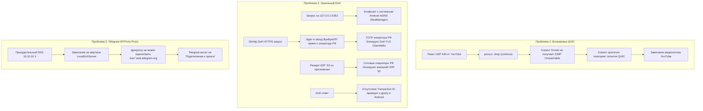

# План доработки после стабилизации на v1.2.1 и технический пост-мортем

> [!IMPORTANT]
> Базовой стабильной версией проекта зафиксирована **v1.2.1**.
> Все наработки, скрипты и изменения веток v1.3.0–v1.3.3 сохранены в архивной ветке git [`archive/v1.3.x-unstable`](https://github.com/ntvampire/MultiBypass/tree/archive/v1.3.x-unstable).
> Никакой код и проектные решения не утеряны. Данный документ определяет архитектуру и безопасный порядок повторного внедрения функций.

---

## 1. Анализ стабильности v1.2.1 (Baseline)

### Почему v1.2.1 работает стабильно на мобильных сетях:
1. **Прямой SmartDNS через туннель**:
   - VPN-интерфейс (`MultiBypassVpnService`) передает реальный IP выбранного DNS-провайдера (например, `143.20.64.55` для BezMezhAU или `193.233.112.67` для GeoHide) напрямую в `builder.addDnsServer()`.
   - Запросы DNS (UDP 53) от приложений туннеля перехватываются `hev-socks5-tunnel` и идут через SOCKS5 UDP-ассоциацию ByeByeDPI.
   - Запросы не перехватываются локальными пользовательскими сокетами и не конфликтуют с Android OS.
2. **Отсутствие вмешательства в UDP 443 (QUIC)**:
   - В C-коде `proxy.c` нет фильтрации QUIC, туннель не сбрасывается и не дропает пакеты молча (blackholing).
3. **Корректная работа Telegram MTProto Proxy**:
   - Прокси `127.0.0.1:1443` успешно резолвит домены дата-центров Telegram через системный DNS и подключается без зависаний.
4. **Уже присутствующие функции в v1.2.1**:
   - Плитки быстрых настроек шторки Android (`VpnTileService`, `TelegramProxyTileService`).
   - Автоматический выбор популярных приложений при первом запуске (Zero-Config).
   - Пресеты GeoHide DNS и BezMezhAU DNS.
   - Сторожевой таймер (Watchdog) и защита от зависания сервиса при остановке.

---

## 2. Технический Post-Mortem: Почему возникла нестабильность в v1.3.0–v1.3.3

### Детальные причины сбоев:
1. **QUIC (UDP 443)**:
   - В `proxy.c` директива `if (g_block_quic && ntohs(addr.in.sin_port) == 443) continue;` молча отбрасывала пакет.
   - Для Chromium/YouTube silent drop означает потерю пакета на линии: стек QUIC ожидает ответа секундами и делает повторные попытки (exponential backoff). Мгновенный откат на TCP HTTP/2 происходит **только** при получении `ECONNREFUSED` (ICMP Port Unreachable) или при отключении UDP в tun2socks.
2. **DoH (DNS-over-HTTPS)**:
   - **Порт 5353**: конфликт с системной службой Android mDNS (`mdnsd`).
   - **Блокировка ТСПУ**: приложение `com.multibypass.app` исключено из VPN-туннеля. Его исходящие HTTPS-запросы к серверам DoH шли напрямую через сотового оператора без десинхронизации ByeByeDPI. В РФ прямые запросы к зарубежным DoH блокируются ТСПУ.
   - **Блокировка UDP 53 сотовыми сетями**: fallback-запрос из приложения через чистый `DatagramSocket` режется CGNAT сотовых операторов РФ.
3. **Telegram MTProto Proxy**:
   - Привязка резолвера устройства к `10.10.10.1` лишала нативную библиотеку `tgwsproxy` возможности получить адреса веб-сокетов Telegram.

---

## 3. Спецификация сохраненных функций для поэтапного внедрения

### 3.1. Автоматизация списков доменов (Domain Sync Pipeline)
- **Конфигурация GitHub Actions**: [`.github/workflows/update_domains.yml`](https://github.com/ntvampire/MultiBypass/blob/archive/v1.3.x-unstable/.github/workflows/update_domains.yml).
  - Запуск по cron в нетипичное время: `23 1 * * *` (01:23 UTC).
  - Публикация в ветку `gh-pages` через GitHub Pages.
- **Скрипт синхронизации**: [`scripts/update_domains.py`](https://github.com/ntvampire/MultiBypass/blob/archive/v1.3.x-unstable/scripts/update_domains.py).
  - **Источники**:
    - DNS Seeds: `seeds/seeds_dns.txt` (ChatGPT, Claude, Copilot, Canva, Notion, Spotify, Xbox, **Gemini / Google Assistant mobile stack**).
    - Anti-DPI Seeds: `seeds/seeds_antidpi.txt` (YouTube, Discord, Instagram, Twitter/X, Facebook, Medium, LinkedIn, BBC, торрент-исключения).
    - Внешние источники: `community-antizapret` и др.
  - **Правила фильтрации**:
    - Очистка от десктопного балласта (трекеры, рутрекеры, казино).
    - Исключение национальных зон (`.ru`, `.su`, `.by`, `.рф`) и доменов российских банков (`sberbank.ru`, `tbank.ru` и др.).
    - Дедупликация и сортировка.
- **Хранилище в приложении**:
  - `domains_dns.txt` и `domains_antidpi.txt` в assets (офлайн база).
  - Сетевая синхронизация через `https://ntvampire.github.io/MultiBypass/`.
  - Трехуровневая модель в `SettingsRepository`: встроенные + синхронизированные + пользовательские (добавленные вручную пользователем сохраняются навсегда).

### 3.2. Обход локальных подсетей (Bypass LAN)
- Добавление опции в настройки: исключение подсетей `10.0.0.0/8`, `172.16.0.0/12`, `192.168.0.0/16`, `127.0.0.0/8` из туннелирования.
- Включение через список явных публичных подсетей в `VpnService.Builder`.

### 3.3. Модульный «Сетевой Доктор» (Network Diagnostics)
- Диагностический инструмент, не влияющий на маршрутизацию:
  1. Проверка статуса VPN-интерфейса и режима раздельного туннелирования.
  2. Проверка сокета ByeByeDPI (`127.0.0.1:1080`).
  3. Проверка резолвинга DNS выбранного провайдера.
  4. Проверка MTProto прокси Telegram (`127.0.0.1:1443`).
  5. Проверка доступности YouTube через ByeByeDPI SOCKS5 (`generate_204`).

### 3.4. Замер задержки в автоподборе стратегий
- Отображение фактического времени отклика в миллисекундах для каждой стратегии десинхронизации.

---

## 4. Дорожная карта безопасного внедрения (Roadmap)

| Этап | Задача | Зависимости | Риск для стабильности |
|:---|:---|:---|:---:|
| **Этап 0** | **Откат на v1.2.1 и проверка базовой стабильности на устройстве** | Текущая точка | Нулевой (возврат к проверенной базе) |
| **Этап 1** | Внедрение пайплайна списков доменов (скрипты, seeds, GitHub Actions, assets) | Без изменений ядра VPN | Нулевой |
| **Этап 2** | Включение обхода локальных сетей (Bypass LAN) как опции в настройках | `MultiBypassVpnService` | Низкий |
| **Этап 3** | Добавление автономного «Сетевого Доктора» для диагностики соединений | UI + фоновый тест | Низкий |
| **Этап 4** | Добавление замеров задержки (мс) в экран автоподбора стратегий | `AutoStrategyScreen` | Низкий |
| **Этап 5** | Доработка QUIC: вместо отбрасывания пакетов — штатное отключение UDP в tun2socks для принудительного TCP fallback | C-код / yml tun config | Средний (требует стендового тестирования) |
| **Этап 6** | DoH: опциональный режим с маршрутизацией HTTPS через ByeByeDPI SOCKS5 | OkHttp + SOCKS5 | Средний |
